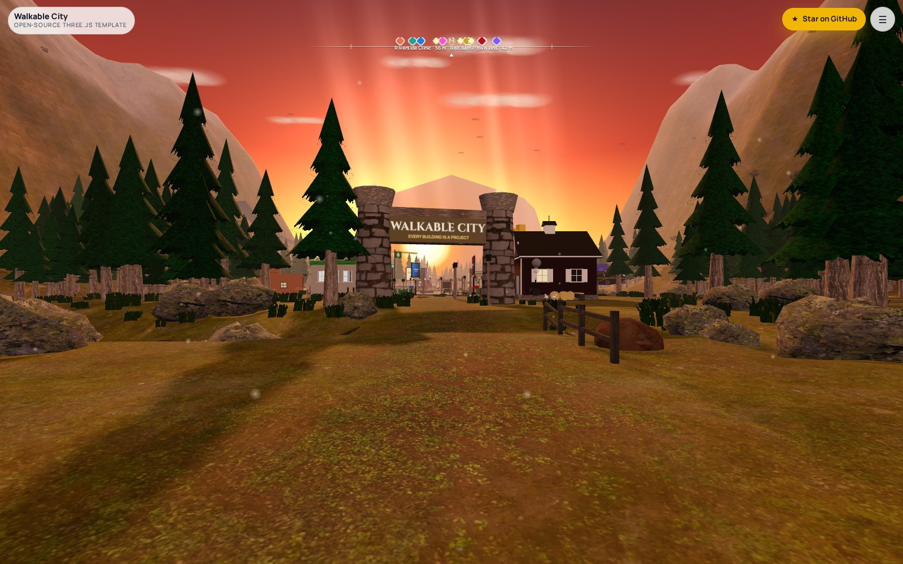

# Walkable City

**A walkable 3D town at sunset where every project in your portfolio is a building.**
One HTML file, [three.js](https://threejs.org) r170, no build step, runs on phones. MIT.

[**Live demo →**](https://thebaileyperspective.com/open-source/walkable-city/) · [The original: Client City](https://thebaileyperspective.com/cityview/) · [three.js forum thread](https://discourse.threejs.org/t/client-city-a-walkable-3d-portfolio-city-built-with-three-js/95487)



## What you get

- **A procedural valley.** Displaced terrain with an analytic height function, a four-way texture splat (grass / dirt / rock / snow) injected into `MeshStandardMaterial`, a river with a procedural ripple normal map, a road spline with a bridge placed where it crosses the river, a cobbled town square.
- **A forest without a GPU bill.** Pines, rocks, grass tufts and bushes as `InstancedMesh` (about 5,700 instances on desktop, 2,000 on phones).
- **Sunset.** Sky shader, sun sprite, god-ray planes, fog, soft shadows, lit windows and lamps, birds, dust motes.
- **Nine building styles** you can assign to any project: `cabin`, `saucer`, `chapel`, `market`, `studio`, `gate`, `clinic`, `barn`, `arcade`. Each is a small hand-built kit of boxes, cylinders and canvas textures, with a yard, a sign, a street-side screen and an invisible collision box.
- **Wayfinding.** A Skyrim-style compass bar, place-name banner, wooden signposts at every junction, and a directory that walks you to any building along the road.
- **Controls.** Drag to look, WASD / arrows to walk, Shift to run, Enter at a door to visit, M for the directory. Phones get a joystick, tap-to-walk and a lighter world. `prefers-reduced-motion` is respected. `?arrive=sky` starts with a descent from above.
- **Zero dependencies at runtime** beyond the vendored `three.module.min.js`. Fonts come from Google Fonts; delete the `<link>` if you want it fully offline.

## Quick start

```bash
git clone https://github.com/YOUR-GITHUB/walkable-city
cd walkable-city
npx --yes serve .        # or: python3 -m http.server 8080
```

Open the URL it prints. That's it. There is nothing to compile.

## Make it yours

Everything that describes *your* town lives in two places inside `index.html`.

### 1. The directory (`<ol id="list">`)

Each `<li data-site="…">` is one building. The list is also the UI, so what you write here is what visitors read.

```html
<li data-site="cabin" data-style="cabin" data-tint="#d62839"
    data-kind="3D storybook website" data-href="https://example.com/"
    data-logo="logos/example.png" data-shot="shots/example.jpg">
  <button type="button"><i class="dot" style="--tint:#d62839"></i>
    <div><b>Example Co</b><i>Snowy log cabin</i><span>One sentence about the project.</span></div>
  </button>
  <a class="ext" href="https://example.com/" target="_blank" rel="noopener">↗</a>
</li>
```

| attribute | required | what it does |
|---|---|---|
| `data-site` | yes | unique key; must also appear in `PLOTS` |
| `data-style` | yes | which builder draws it: `cabin` `saucer` `chapel` `market` `studio` `gate` `clinic` `barn` `arcade` |
| `data-tint` | yes | accent colour for the sign border, compass marker and card |
| `data-kind` | yes | short label on the card |
| `data-href` | yes | where "Visit site" goes |
| `data-logo` | no | PNG painted onto the sign; without it the name is painted instead |
| `data-shot` | no | 16:10 screenshot for the little street-side screen; without it a tinted placeholder is painted |
| `data-signbg` | no | sign background colour (for light logos) |

One `<li data-landmark>` is the sun at the end of the road, a clickable "home" link. One `<li data-lot>` describes the open lots.

### 2. The town plan (`PLOTS`, in the script)

```js
const PLOTS = {
  barn:   { t: .21, side: +1, off: 13 },   // lane plot: t along the road (0..1), side, metres off the centre line
  cabin:  { x: 26, z: -16 },               // square plot: absolute position, faces the square
  lot0:   { t: .33, side: +1, off: 12 },   // open lot
  …
};
```

`ROAD_PTS` and `RIVER_PTS` are Catmull-Rom splines, `SQUARE` is the cobbled square, `LOTS` lists the empty plots. Move things, add plots, lengthen the road: the terrain flattens under every plot and road sample automatically.

### Add a building

1. Add a `<li>` to the directory with a new `data-site` key and a `data-style`.
2. Add the same key to `PLOTS` with a lane or square position.
3. Reload. The signposts, compass, directory walk-to and collision all pick it up.

### Add a building style

Builders live in the `BUILDERS` object: `name(g, s) { … return { w, d } }`. You get the group `g` (already placed and rotated to face the road), the site `s` (name, tint, logo…), and helpers: `box`, `cyl`, `cone`, `plane`, `torus`, `pbr('planks', 2, 1)` for textured materials, `mat('#hex')` for flat ones, and the kit `K` (benches, chairs, planters, posters, stones, tufts, string lights, fences). Return the footprint and the engine adds the yard, sign, screen and collision for you.

### Analytics

The engine calls `window.cityTrack(event, params)` if you define it (`city_enter`, `city_visit`, `city_lot`, `city_star`). Nothing is sent anywhere by default.

## Performance notes

- Desktop: 250-segment terrain, normal maps, 2.5k pines, PCF soft shadows, pixel ratio up to 2.
- Phones / small GPUs (`pointer: coarse` or ≤ 4 cores): 160-segment terrain, `_s` texture copies, no normal maps, 900 pines, pixel ratio 1.4, no MSAA.
- Gold and chrome use `metalness ≤ .35`; there is no environment map, so high metalness renders black.
- Everything is one draw-call-friendly group per building; the whole town is ~120 draw calls on desktop.

## Credits and license

Code: MIT, © 2026 John Bailey / [The Bailey Perspective](https://thebaileyperspective.com). Textures: [Poly Haven](https://polyhaven.com), CC0 (see `CREDITS.md`). three.js: MIT.

This template is the engine behind [Client City](https://thebaileyperspective.com/cityview/), the walkable portfolio of a small studio in Greenville, SC that builds 3D websites, custom CRMs and web apps. If you ship a town with it, open an issue with the link; we keep a list.
